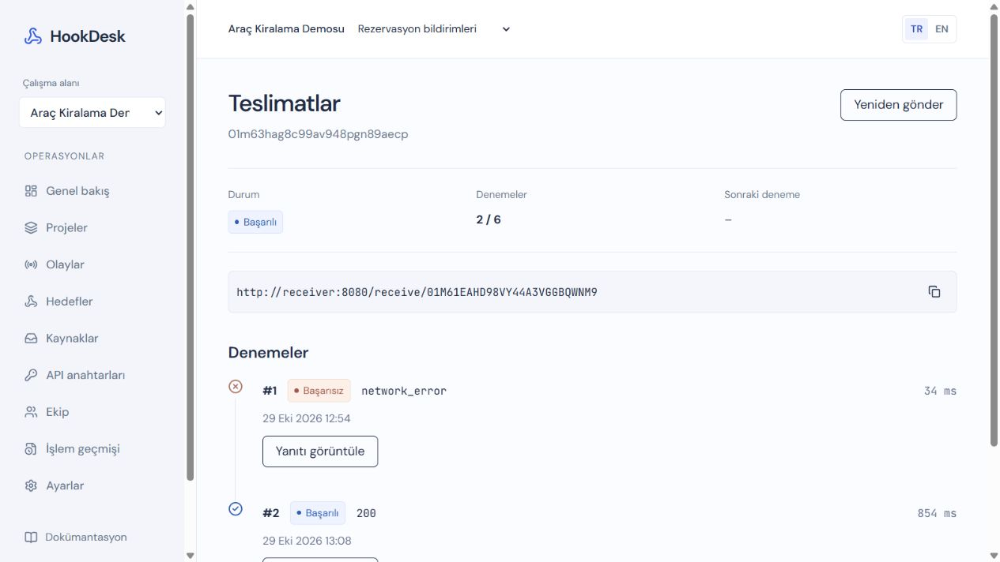

# HookDesk

**English** · [Türkçe](README.md) · [Architecture](docs/architecture/overview.md) · [API](docs/api/openapi.json) · [Testing](docs/runbooks/testing.md)

I built HookDesk to manage webhook delivery between applications and make each delivery traceable. The starting point was a common failure: a destination goes offline, an event cannot be delivered, and there is no clear record of what happened or a way to retry it.

I separated the Laravel 13 backend from the React 19 and TypeScript frontend. PostgreSQL stores events and delivery state; Redis handles queueing, caching and rate limits.

## Short demo

[2:40 demo video](docs/demo/hookdesk-demo.mp4)

The video demonstrates reservation creation, a receiver outage and automatic retries in the local Docker environment. It includes Turkish captions and shortened waiting periods.

[](docs/demo/hookdesk-demo.mp4)

## Features

- Email verification, password recovery and optional two-factor authentication for regular users.
- Workspaces, projects, team invitations and role-based permissions.
- Project API keys and incoming webhook sources.
- Event-type subscriptions and outgoing requests signed with HMAC-SHA256.
- Automatic retries, manual replays and an attempt history for each delivery.
- Idempotency support to prevent duplicate events when a request is repeated.
- Usage limits, endpoint pausing and audit logs.
- Super Admin controls and support sessions without a time limit, restricted to the assisted user's permissions.
- English and Turkish interfaces.

## Delivery flow

1. The API validates the key, project access and usage limits.
2. The event and its deliveries are saved in one PostgreSQL transaction.
3. A worker sends the signed HTTP request and records the result.
4. Transient failures are rescheduled. A scheduler recovers due or interrupted work from the database if queue messages are lost.

A `202` response means the event has been durably accepted. Delivery order is not guaranteed, and a destination may receive the same event more than once. I included event-ID deduplication in the example receiver for that reason.

## Stack

- **Backend:** PHP 8.4, Laravel 13, Eloquent, Sanctum and Fortify.
- **Frontend:** React 19, TypeScript, Vite, React Router, TanStack Query, Tailwind CSS, shadcn/ui and i18next.
- **Data and infrastructure:** PostgreSQL 18, Redis 8, Docker Compose, Caddy and Mailpit.
- **Testing and quality:** Pest, Larastan, Pint, Vitest, React Testing Library, Playwright and GitHub Actions.

## Getting started

Docker Engine and Docker Compose are required. On Windows, use Docker Desktop with Linux containers and WSL 2.

```sh
git clone https://github.com/Beratcan-Polat/HookDesk.git
cd HookDesk
```

### Windows

The setup script prepares the environment file, generates the application key, starts the services and runs migrations:

```powershell
.\infra\scripts\setup.ps1
```

### Linux

From a fresh clone:

```sh
cp .env.example .env
docker compose build app
docker compose run --rm --user root app composer install --no-interaction
docker compose run --rm --user root app sh -c 'chown -R www-data:www-data vendor storage bootstrap/cache'
docker compose run --rm app php artisan key:generate --show
```

Set `APP_KEY` in the root `.env` file to the value printed by the last command, then run:

```sh
docker compose up -d
docker compose exec app php artisan migrate --force
```

- Application: [localhost:8080](http://localhost:8080)
- Development email: [localhost:8025](http://localhost:8025)

To check the running Docker stack end to end with Node.js 24:

```sh
node infra/scripts/smoke.mjs
```

This exercises registration, email verification, API keys, signed delivery and retries against the actual services. I documented setup, restarts and the recovery check in the [Docker development guide](docs/runbooks/docker-development.md).

I also documented [development without Docker](docs/runbooks/native-development.md).

## Trying the application

Register through the application and open the verification email in Mailpit. To start with a sample workspace instead:

```sh
docker compose exec app php artisan hookdesk:demo
```

This creates a development account with a random password and a test destination. Credentials are printed in the command output. The destination returns `500` for its first two requests and `200` for the next one, making the retry history visible in the dashboard. This command is disabled in production.

To create the first Super Admin, use an active account with a verified email address:

```sh
docker compose exec app php artisan hookdesk:admin admin@example.com
```

### Administration and support

Super Admin accounts sign in with email and password; no Authenticator code is required. Sensitive changes require a reason and a password confirmation valid for five minutes. This confirmation window does not limit the support session.

I built support sessions so an administrator can investigate an issue and work within the assisted user's workspace permissions:

- Support sessions have no time limit. The administrator ends them manually; starting another session ends the previous one.
- Membership and permissions are checked on every request. Account suspension or removal of the administrator role revokes access.
- Audit records retain both the administrator and the user being assisted.

Regular users can optionally enable two-factor authentication on their own accounts.

## API usage

Publish events through `POST /api/v1/events`, using a project API key in the `Authorization: Bearer ...` header and `Content-Type: application/json`:

```json
{
  "type": "order.created",
  "data": {
    "order_id": "ORD-1042",
    "amount": 1200
  }
}
```

The optional `Idempotency-Key` header maps an identical raw request body to the same event for 24 hours. I included an [example receiver](examples/receiver.php) for signature verification and deduplication, and an [OpenAPI contract](docs/api/openapi.json) for the API routes.

## Vehicle rental integration

I connected HookDesk to reservation confirmations in my vehicle rental project. The Java application saves the reservation and its outbound event in one MySQL transaction. HookDesk accepts `rental.created` and delivers the signed event to the Python email service.

I tested normal delivery, a receiver outage and recovery of events queued in Java while HookDesk was unavailable, using a separate Docker stack. All three scenarios passed locally and in GitHub Actions. The integration lives on a [separate branch](https://github.com/Beratcan-Polat/arac-kiralama/tree/feature/hookdesk-integration), preserving the rental project's main version. The [integration guide](https://github.com/Beratcan-Polat/arac-kiralama/blob/feature/hookdesk-integration/docs/hookdesk-integration.md) covers setup and usage; the [demo guide](docs/portfolio-demo.md#reservation-integration) provides a short walkthrough.

## Tests

```sh
cd backend
php vendor/bin/pest
php vendor/bin/pint --test
php vendor/bin/phpstan analyse --memory-limit=512M

cd ../frontend
npm run lint
npm run test
npm run build
```

PostgreSQL and Redis integration tests require isolated test databases. Playwright journeys require the application services to be running. Environment variables and commands are in the [testing guide](docs/runbooks/testing.md); recorded results are in the [validation notes](docs/verification.md).

I added a separate Docker load-test harness for acceptance latency, queue/delivery times and worker scaling. Run `node infra/performance/run.mjs` from the repository root. It creates an isolated stack and saves JSON/HTML reports. The [performance guide](docs/runbooks/performance.md) explains the workload and measurement limits.

## Documentation

- [Architecture and delivery model](docs/architecture/overview.md)
- [Technical decisions](docs/decisions)
- [API authentication](docs/api/authentication.md)
- [End-to-end demo](docs/portfolio-demo.md)
- [Linux deployment, backups and recovery](docs/runbooks/deployment.md)
- [Release checks](docs/runbooks/smoke-check.md)

The project is in development; a public demo has not been deployed yet. Production deployment requires domain, SMTP and server configuration.

## License

[MIT](LICENSE)
